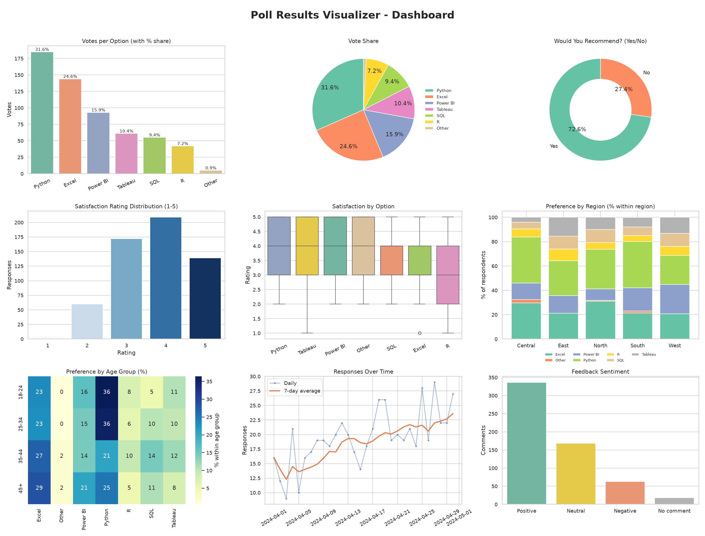
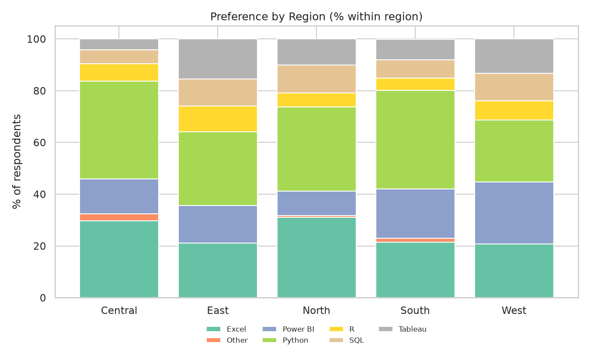
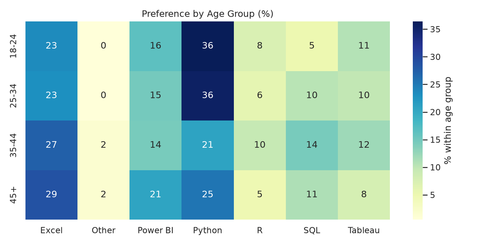

# 📊 Poll Results Visualizer

> An end-to-end survey analytics pipeline: messy poll data → cleaning → analysis → charts → plain-English insights → interactive Streamlit dashboard.



## 🎯 Problem
Polls and surveys (Google Forms, SurveyMonkey, Qualtrics exports) produce raw rows that are hard to read, full of typos, duplicates and blanks, and useless for decisions until they are cleaned and summarised.

## ✅ Solution
This project ingests a poll CSV (or generates a realistic synthetic one), cleans it, computes vote share, ratings, regional/age comparisons and sentiment, draws charts, writes an insights report, and serves everything in a filterable dashboard.

## ✨ Features
- Handles 4 question types: multiple choice, Yes/No, Likert (1-5), open text
- Cleaning pipeline with an audit log (duplicates, typos like `powerbi`/`POWER BI`, invalid ratings like `7` or `four`, missing values)
- Vote/share table with **95% margin of error**
- Region, age-group and gender comparisons (stacked bar, heatmap)
- Response trend with 7-day rolling average
- Lexicon-based sentiment + keyword/word cloud for open-text feedback
- Auto-generated insights report (`outputs/insights_report.md`)
- Streamlit dashboard with filters, CSV upload and cleaned-data download
- Reproducible (seeded) synthetic data + unit tests

## 🧰 Tech Stack
Python 3.12 · Pandas · NumPy · Matplotlib · Seaborn · Plotly · WordCloud · Streamlit · Pytest

## 🗂️ Structure
```
Poll-Results-Visualizer/
├── data/        raw + cleaned CSVs
├── notebooks/   exploration notebooks
├── src/         config, generate_data, cleaning, analysis, visualize, insights, text_utils
├── outputs/     summary tables + insights_report.md
├── images/      all charts (PNG)
├── docs/        full guide + interview prep
├── tests/       pytest tests
├── app.py       Streamlit dashboard
├── main.py      run the whole pipeline
└── requirements.txt
```

## 🚀 How to Run
```bash
git clone https://github.com/arppitha-ai/Poll-Results-Visualizer.git
cd Poll-Results-Visualizer
python3 -m venv venv && source venv/bin/activate     # Windows: venv\Scripts\activate
pip install -r requirements.txt

python main.py                  # full pipeline -> data/, outputs/, images/
streamlit run app.py            # interactive dashboard
python main.py --input my_poll.csv   # use your own Google Forms export
pytest -q                       # run tests
```

## 📈 Sample Results (synthetic poll, 585 valid responses)
| Option | Votes | Share |
|---|---|---|
| Python | 185 | 31.6% |
| Excel | 144 | 24.6% |
| Power BI | 93 | 15.9% |
| Tableau | 61 | 10.4% |
| SQL | 55 | 9.4% |
| R | 42 | 7.2% |

- Python leads overall (±3.8 pts); **West** is the exception and prefers Power BI
- 18-34 prefer Python, 35+ prefer Excel
- Average satisfaction 3.71/5; 72.6% would recommend their tool
- Full report: [`outputs/insights_report.md`](outputs/insights_report.md)

## 🖼️ Screenshots
| Vote share | Region | Age |
|---|---|---|
|  |  |  |

Add your Streamlit screenshot as `images/streamlit_dashboard.png`.

## 🔮 Future Improvements
Live polling (Google Sheets/Forms API), ML sentiment (VADER/transformers), Power BI version, real-time refresh, significance tests (chi-square), PDF report export.

## 📝 Note on data
The default dataset is **synthetic** (generated by `src/generate_data.py`) and contains deliberate errors to demonstrate cleaning. Findings describe the simulated data, not real-world opinion.

## 👤 Author
**arppitha-ai** · built as a portfolio project for Data/Business/Research Analyst roles.
