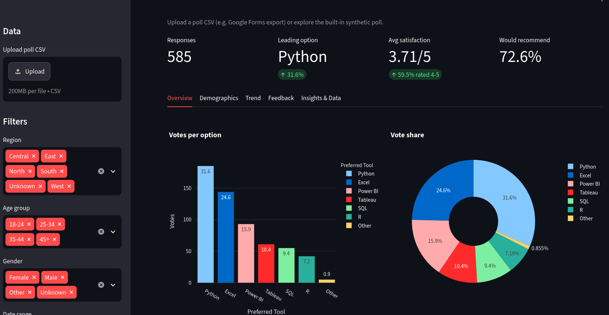
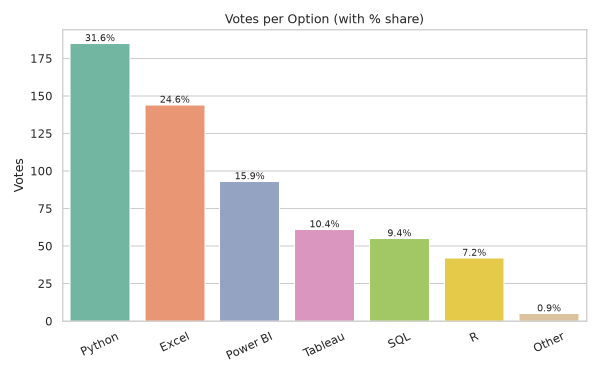
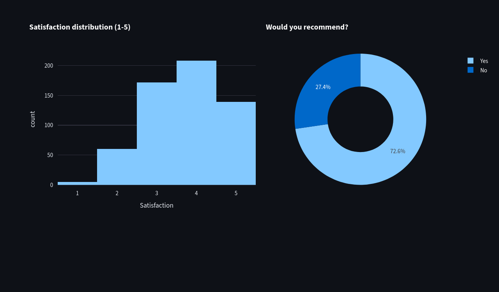
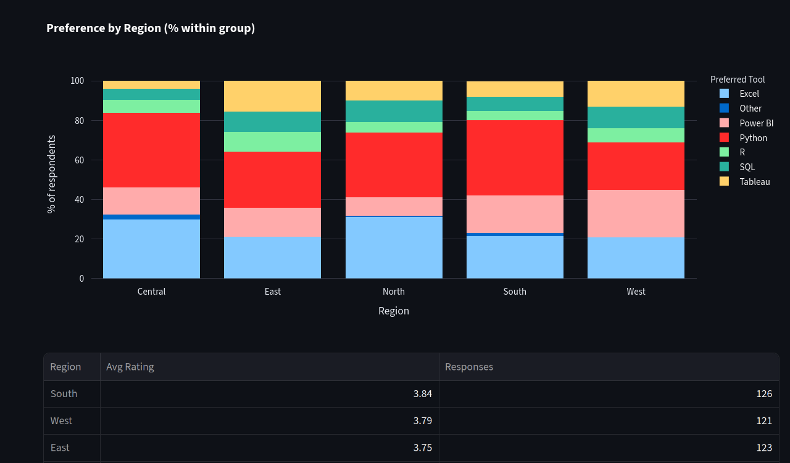
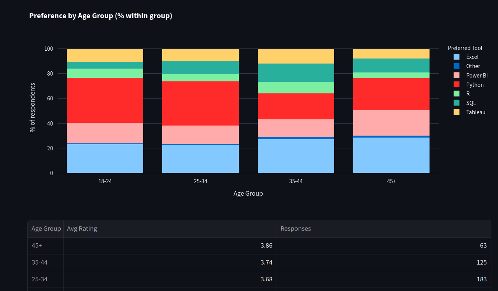
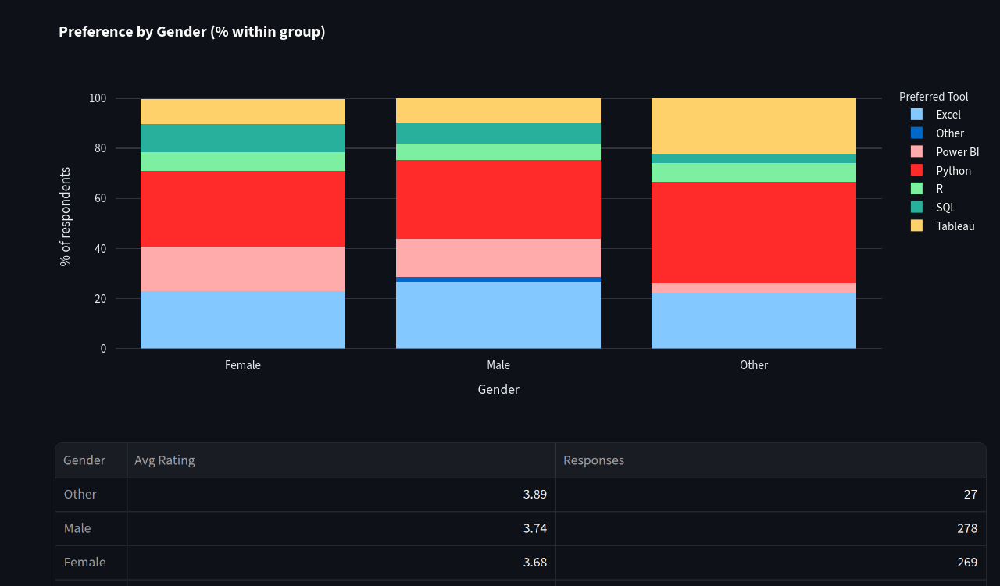
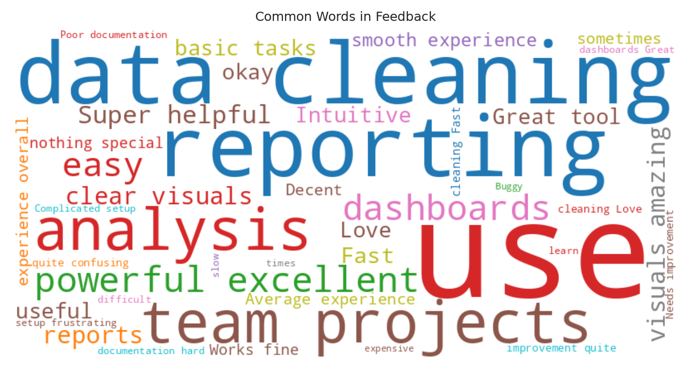

# 📊 Poll Results Visualizer

> An end-to-end survey analytics pipeline: messy poll data → cleaning → analysis → charts → plain-English insights → interactive Streamlit dashboard.



## 🎯 Problem
Poll and survey exports (Google Forms, SurveyMonkey, Qualtrics) are full of typos, duplicates and blanks, and are hard to read until they are cleaned and summarised.

## ✅ Solution
This project imports a poll CSV (or generates a realistic synthetic one), cleans it, computes vote share, ratings, regional/age comparisons and sentiment, draws charts, writes an insights report, and serves everything in a filterable dashboard.

## ✨ Features
- Handles multiple choice, Yes/No, Likert (1-5) and open-text questions
- Cleaning pipeline with an audit log (duplicates, typos, invalid ratings, missing values)
- Vote share with 95% margin of error
- Region, age-group and gender comparisons
- Response trend with 7-day rolling average
- Lexicon-based sentiment and word cloud for open-text feedback
- Auto-generated insights report
- Streamlit dashboard with filters, CSV upload and cleaned-data download

## 🧰 Tech Stack
Python 3.12 · Pandas · NumPy · Matplotlib · Seaborn · Plotly · WordCloud · Streamlit

## 🚀 How to Run
```bash
git clone https://github.com/arppitha-ai/Poll-Results-Visualizer.git
cd Poll-Results-Visualizer
python3 -m venv venv && source venv/bin/activate
pip install -r requirements.txt
python main.py          # cleaning + analysis + charts + insights report
streamlit run app.py    # interactive dashboard
python main.py --input my_poll.csv   # use your own Google Forms export
```

## 📈 Sample Results (synthetic poll, 585 valid responses)
| Option | Votes | Share |
|---|---|---|
| Python | 185 | 31.6% |
| Excel | 144 | 24.6% |
| Power BI | 93 | 15.9% |
| Tableau | 61 | 10.4% |
| SQL | 55 | 9.4% |
| R | 42 | 7.2% |

- Python leads overall (±3.8 pts); the West region prefers Power BI
- Ages 18-34 prefer Python, ages 35+ prefer Excel
- Average satisfaction 3.71/5; 72.6% would recommend their tool

## 🖼️ Screenshots
| Votes | Satisfaction |
|---|---|
|  |  |

| Region | Age group | Gender |
|---|---|---|
|  |  |  |



## 📝 Note on data
The default dataset is **synthetic** (`src/generate_data.py`) with deliberate errors to demonstrate cleaning. Findings describe the simulated data, not real-world opinion.

## 👤 Author
**arppitha-ai**
